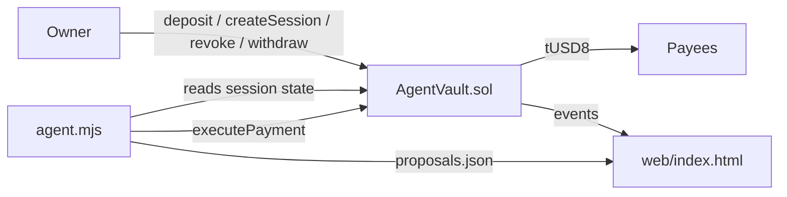

# AgentPay Guard

**An AI assistant that can pay — but only inside guardrails enforced on-chain.**

AgentPay Guard is a submission to the **Aevum Builder Challenge #1** (QDay, on DoraHacks), **Native AI Assistants** track. It answers a simple question: *if you let an AI agent move your money, what stops it from moving too much, to the wrong place, or after you changed your mind?*

The answer here is not a promise — it is a smart contract. The owner funds a personal vault with the test stablecoin **tUSD8** and grants the agent a **scoped session**: a total spending cap, a per-payment cap, an expiry time, and an allowlist of recipients. The vault contract enforces all four on every payment, emits a permanent audit trail, and lets the owner revoke the session instantly. The agent itself double-checks the same rules before sending anything, so a doomed transaction never wastes gas — but even a compromised agent cannot exceed the guardrails, because the contract re-checks them on-chain.

## The problem

AI agents are starting to pay for things: freelancer invoices, subscriptions, API credits, supplier orders. Today that usually means handing the agent a wallet key or an exchange API key with effectively unlimited power. One bad prompt, one prompt-injection in an invoice email, one bug — and the agent can drain the account, pay an attacker-controlled address, or keep spending long after its job ended.

Existing fixes are off-chain policies: rate limits in a backend, a human approval queue. They work until the backend is bypassed or the approver is asleep. AgentPay Guard moves the enforcement to where the money is: the chain.

## How it works

```
                    ┌─────────────────────┐
  Owner (you)       │    AgentVault       │
  ───────────       │    (Solidity)       │
  1. deposit tUSD8──▶  holds funds        │
  2. create session──▶  session: agent,   │
     cap / per-tx / │  cap, per-tx cap,   │
     expiry /       │  expiry, allowlist  │
     allowlist      └──────┬──────────────┘
                            │ executePayment()
                    ┌───────▼──────────────┐
  AI agent          │  checks, on-chain:   │
  ────────          │  caller == agent?    │
  reads invoices,   │  revoked? expired?   │
  checks guardrails │  recipient allowed?  │
  off-chain, then   │  ≤ per-tx cap?       │
  executes          │  ≤ remaining cap?    │
  approved ones     │  vault funded?       │
                    └──────┬──────────────┘
                           │ tUSD8 transfer + PaymentExecuted event
                    ┌──────▼───────────────┐
                    │  Payees + audit log  │
                    │  (explorer links)    │
                    └──────────────────────┘
  Owner can revoke the session or withdraw remaining funds at any time.
```

### Workflows

1. **Fund** — Owner approves the vault and deposits tUSD8 (`deposit`). Anyone may fund the vault; only the owner withdraws or grants sessions.
2. **Grant** — Owner creates a session for one agent address with cap, per-payment cap, expiry, and recipient allowlist (`createSession`). This is the moment of human approval: the session *is* the approval, scoped.
3. **Propose** — The demo agent (`agent/agent.mjs`) reads invoices, re-reads live session state before each decision, and logs approve/reject with a plain-language reason. An optional LLM review hook (disabled by default) can veto a payment but can never approve one the policy rejected.
4. **Execute** — Approved payments go through `executePayment`, which re-checks every guardrail on-chain and emits `PaymentExecuted` with the invoice memo.
5. **Audit** — The web UI reads all vault events and renders the audit trail with Aevum explorer links.
6. **Revoke** — Owner calls `revokeSession`; the session dies immediately and permanently. Remaining funds stay withdrawable.

## Architecture



| Component | What it is |
|---|---|
| `src/AgentVault.sol` | The vault + session guardrails. Dependency-free Solidity, custom errors, full event audit trail. |
| `src/MockTUSD8.sol` | Minimal 6-decimal ERC-20 for **local testing only**. Never deployed to Aevum. |
| `test/AgentVault.t.sol` | 23 Foundry tests: caps, expiry, allowlist, revocation, caller checks, owner controls, events. |
| `script/DeployLocal.s.sol` | Deploys mock + vault to anvil. |
| `script/DeployAevum.s.sol` | Deploys the vault to Aevum testnet against real tUSD8. Key via Foundry keystore, never in code. |
| `agent/agent.mjs` | Deterministic rule-based payment agent (Node + ethers v6). Decision log + `proposals.json` output. |
| `agent/invoices.json` | Demo invoice batch: 2 payable, 1 over the per-payment cap, 1 non-allowlisted. |
| `web/index.html` | Single-page dashboard: vault balance, session status + countdown, owner actions, agent proposals, audit log with explorer links. No build step; ethers via CDN. |
| `scripts-local/run-e2e.sh` | One-command local end-to-end run on anvil (see below). |
| `Dockerfile` | Serves the demo UI as a packaged image. |

## Setup & reproduction

Prerequisites: [Foundry](https://book.getfoundry.sh/getting-started/installation) (`forge`, `cast`, `anvil`) and Node.js 18+.

```bash
git clone --recursive <repo-url> && cd agentpay-guard
forge build
forge test        # 23 tests, all passing

# Full local end-to-end (deploys, funds, grants a session, runs the agent,
# verifies balances, revokes, and proves the revoked session cannot pay):
bash scripts-local/run-e2e.sh

# Demo UI (local mode: point MetaMask at http://127.0.0.1:8545, chain 31337):
cd web && python3 -m http.server 8080
```

The agent on its own:

```bash
cd agent && npm install
node agent.mjs --dry-run   # decisions only, no transactions
node agent.mjs             # decide + execute
```

Environment variables for the agent: `RPC_URL`, `VAULT_ADDRESS`, `SESSION_ID`, `AGENT_KEY`, `INVOICES_FILE`. Defaults target a local anvil run.

### Deploy to Aevum testnet

```bash
# Import the deployer keystore ONCE (Foundry keystore, never a raw key in the repo):
cast wallet import aevum --keystore <path-to-keystore.json>

forge script script/DeployAevum.s.sol \
  --rpc-url https://rpc-test.qday.info \
  --account aevum --sender <deployer-address> --broadcast
```

Then paste the vault address into `web/index.html` (`VAULT_ADDRESS`) and record it below. The deployer needs tQDAY for gas (faucet: https://faucet.qday.info) and tUSD8 for funding the vault.

## Testnet addresses (Aevum, chain 44005)

| Contract | Address | Explorer |
|---|---|---|
| tUSD8 (official) | `0x456569838f1d43009A91ebA4263147Afd7233483` | [explorer](https://explorer-test.qday.info/address/0x456569838f1d43009A91ebA4263147Afd7233483) |
| AgentVault | `0xf41aA12e0F4152953e7bAe68a1E562a6CD7967B8` | [deploy tx](https://explorer-test.qday.info/tx/0x23006dbd55923f26b443a9e33090c755c31eec9755e34cb32142903961b0d718) |

RPC: `https://rpc-test.qday.info` · Explorer: `https://explorer-test.qday.info` · Faucet: `https://faucet.qday.info`

## Verified live on Aevum testnet (2026-11-16)

Vault funded with 0.6 tUSD8; session 1 granted to the demo agent (cap 0.5, per-payment cap 0.2, 24h, 3 allowlisted payees). The agent then ran against the live vault with `agent/invoices-aevum.json`:

- [INV-001 → Alice, 0.15 tUSD8 — paid](https://explorer-test.qday.info/tx/0x3b0f3de05fc50c606b8caf55d62e117c7b75d20e8f9aa3a0591226dd75947b04)
- [INV-002 → Bob, 0.18 tUSD8 — paid](https://explorer-test.qday.info/tx/0x9b2bae598eb1128c4af80b0d577d42fee496b45f46fca0eabe5b2357975533e0)
- INV-003 (0.25) rejected: exceeds the 0.2 per-payment cap. INV-004 rejected: recipient not on the allowlist.
- Session/funding txs: [deposit](https://explorer-test.qday.info/tx/0x25d01f5b1fdf23afcc33d77d7826c709c1089b748c7907599ac9736fef746b25), [createSession](https://explorer-test.qday.info/tx/0x586f29c8ec7973c874ea6f1491ac464913a19246fe89c86fcb7bcaca39059b4a). Payee balances verified on-chain afterwards (Alice 0.15, Bob 0.18, Carol 0).

## Verified locally

`bash scripts-local/run-e2e.sh` (full transcript in `e2e-local.log`):

- Vault funded with 1,000 tUSD8; session granted (cap 500, per-payment cap 200, 24h, 3 allowlisted payees).
- Agent dry-run: 2 would-pay, 2 rejected with reasons (over per-payment cap; recipient not allowlisted).
- Agent execute: INV-001 (150) and INV-002 (180) paid on-chain; INV-003 and INV-004 rejected. Vault 670, session remaining 170.
- Payee balances verified: Alice 150, Bob 180, Carol 0, unknown vendor 0.
- After owner revocation, a re-run rejects all 4 invoices ("session revoked") and `remainingCap` returns 0.

## Safety & trust notes

- **Least privilege:** the agent key can do exactly one thing — `executePayment` within one session's limits. It cannot withdraw, cannot create sessions, cannot change the allowlist.
- **Expiry + revocation:** sessions die on their own at expiry and instantly on revocation. Revocation is irreversible by design; grant a fresh session instead.
- **Checks-effects-interactions:** `executePayment` updates `spent` before the token transfer.
- **No upgrade path, no admin key:** the only privileged role is the deploying owner. The guardrails cannot be silently widened.
- **No secrets in this repo:** deploy keys live in OS/Foundry keystores; the agent's default key is anvil's public test key, local chains only.
- **Not audited.** This is a hackathon prototype on testnet. Do not use with real value without a professional audit.

## Known limits

- One token per vault (tUSD8); multi-token vaults would need a token registry.
- Sessions are single-agent; multi-agent sessions need a session per agent (cheap and explicit).
- The UI reads events from block 0, which is fine on a fresh testnet deployment but should use indexed queries or a subgraph at scale.
- The demo agent is rule-based; the LLM review hook is a documented stub, veto-only by design.

## Roadmap

- Session top-ups and cap adjustments without revocation (owner-signed, explicit).
- Recurring-payment schedules (e.g., weekly payroll) with per-period caps.
- zkTLS / verifiable invoice attestations so the agent can prove what invoice it paid.
- Multi-token vaults and a subgraph-backed audit UI.

## Tech used

Solidity 0.8.24 · Foundry (forge/cast/anvil) · Node.js + ethers v6 · plain HTML/JS + ethers via CDN · Aevum Testnet (chain 44005, EVM) · tUSD8 (ERC-20, 6 decimals) · Docker (nginx) for the packaged demo.

## License

MIT. Written from scratch for the Aevum Builder Challenge #1 build window (Nov 16 – Dec 11, 2026).
